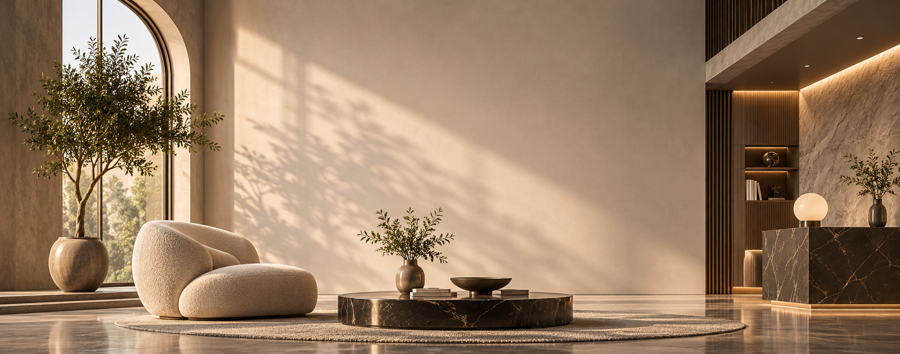
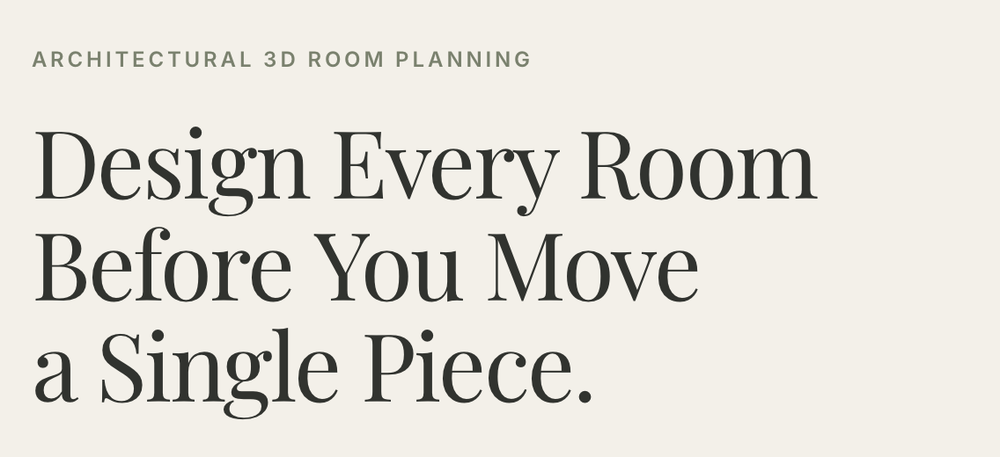
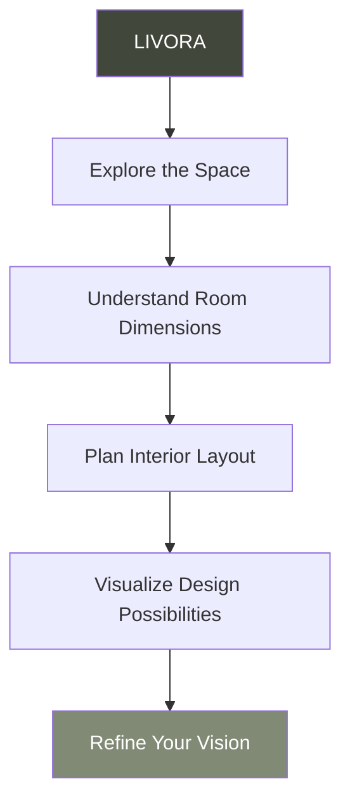

 <div align="center">


<br/>

# L I V O R A

### ARCHITECTURAL 3D ROOM PLANNING

**Design Every Room Before You Move a Single Piece.**

<br/>

[](https://livora-seven-ebon.vercel.app/)


<br/>

*Imagine the space. Visualize the possibilities. Design with confidence.*

</div>

---

<div align="center">



### A DIFFERENT WAY TO THINK ABOUT YOUR SPACE.

</div>

# 01. THE VISION

**What if you could experience your room before moving a single piece of furniture?**

LIVORA is an architectural 3D room-planning experience built around one simple idea: people should be able to imagine, explore, and plan their living spaces before making real-world design decisions.

Traditional room planning often begins with measurements, imagination, and uncertainty.

LIVORA aims to make that process more visual, engaging, and intuitive through a modern digital experience inspired by contemporary architecture and interior design.

> A room is more than four walls. It is an experience waiting to be designed.

# 02. THE LIVORA EXPERIENCE

The experience is built around the relationship between space, design, and visualization.

| Experience | Purpose |
|:---|:---|
| Spatial visualization | Understand the possibilities of a room |
| Room planning | Think about layouts and spatial arrangements |
| Interior aesthetics | Explore the relationship between furniture, materials and design |
| Visual experience | Make room planning engaging and intuitive |
| Modern interface | Navigate an architectural experience with clarity |

# 03. EXPLORE THE INTERFACE

<div align="center">



*An interface inspired by architectural minimalism and contemporary luxury.*

</div>

### Design characteristics

- Warm ivory backgrounds.
- Charcoal typography.
- Muted sage-green accents.
- Elegant editorial-style headings.
- Minimalist architectural compositions.
- Carefully balanced visual hierarchy.

# 04. DESIGN SYSTEM

LIVORA follows a consistent visual language inspired by premium architecture studios.

### Colour palette

| Colour | Hex | Application |
|:---|:---|:---|
| Warm Ivory | `#F3F0E8` | Main backgrounds |
| Charcoal | `#30312D` | Primary typography |
| Muted Sage | `#818A75` | Accent elements |
| Soft Stone | `#D8D2C7` | Secondary surfaces |
| Deep Olive | `#42473B` | Brand identity |

### Typography

- Editorial serif for expressive headlines.
- Clean sans-serif for interface elements.
- Generous letter spacing for architectural labels.
- Strong contrast between headings and supporting content.

# 05. HOW THE PLATFORM IS ORGANIZED

The project can be understood through four main stages.



# 06. TECHNOLOGY & ENGINEERING

LIVORA is deployed through Vercel and is designed as a modern web-based architectural experience.

The exact implementation stack should be reflected from the repository's `package.json`.

| Layer | Technology |
|:---|:---|
| Frontend | Verify from project dependencies |
| Styling | Verify from project dependencies |
| 3D rendering | Verify from project dependencies |
| Animation | Verify from project dependencies |
| Deployment | Vercel |
| Version control | Git and GitHub |

# 07. PROJECT ARCHITECTURE

An illustrative project organization:

```text
LIVORA/
│
├── public/
│   ├── images/
│   ├── models/
│   └── icons/
│
├── src/
│   ├── components/
│   ├── pages/
│   ├── styles/
│   ├── assets/
│   └── utils/
│
├── assets/
│   ├── livora-logo.png
│   ├── livora-hero.png
│   └── livora-preview.png
│
├── package.json
├── README.md
└── ...
```

*The structure above is illustrative. Adjust it to match your actual repository.*

# 08. INSTALLATION & LOCAL DEVELOPMENT

Want to explore LIVORA locally or contribute to its development?

### Prerequisites

- Node.js
- npm (or your project's configured package manager)
- Git

### Step 1 — Clone the repository

```bash
git clone YOUR_GITHUB_REPOSITORY_URL
```

### Step 2 — Navigate into the project

```bash
cd YOUR_PROJECT_FOLDER
```

### Step 3 — Install dependencies

```bash
npm install
```

### Step 4 — Start development

```bash
npm run dev
```

### Step 5 — Open the application

```text
http://localhost:3000
```

*Follow the scripts and environment configuration in your actual project if they differ.*

# 09. DEPLOYMENT

LIVORA is deployed using Vercel.

To deploy your own version:

1. Push your project to GitHub.
2. Import the repository into Vercel.
3. Configure the appropriate build settings.
4. Add any required environment variables.
5. Deploy your application.

**Live application:**

[https://livora-seven-ebon.vercel.app/](https://livora-seven-ebon.vercel.app/)

# 10. FUTURE ROADMAP

The long-term vision for LIVORA extends beyond a visual website.

The following are potential development directions, not claims about currently available features.

- [ ] Interactive 3D room customization.
- [ ] Real-time furniture placement.
- [ ] Dynamic room dimensions and layouts.
- [ ] Furniture libraries and object positioning.
- [ ] Material and texture customization.
- [ ] AI-powered interior design recommendations.
- [ ] Virtual room walkthroughs.
- [ ] Save and share personalized room designs.
- [ ] Multiple architectural styles.
- [ ] Responsive 3D design workspace.

# 11. CONTRIBUTING

Ideas, improvements, and contributions are welcome.

If you would like to contribute:

1. Fork the repository.
2. Create a feature branch.
3. Implement your improvements.
4. Test your changes.
5. Submit a pull request.

# 12. PROJECT DETAILS

| Information | Details |
|:---|:---|
| Project | LIVORA |
| Category | Architectural 3D Room Planning |
| Platform | Web Application |
| Hosting | Vercel |
| Repository | Your GitHub repository |
| Status | Deployed |

# 13. EXPERIENCE LIVORA

<div align="center">


<br/>

# L I V O R A

### SPACE. FORM. EXPERIENCE.

**Design Every Room Before You Move a Single Piece.**

<br/>

[](https://livora-seven-ebon.vercel.app/)

<br/>

*Where imagination meets architecture.*

---

**BUILT WITH CREATIVITY. DESIGNED FOR POSSIBILITY.**

</div>
