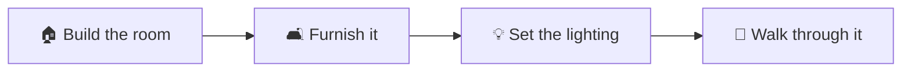

<div align="center">

```
██╗     ██╗██╗   ██╗ ██████╗ ██████╗  █████╗ 
██║     ██║██║   ██║██╔═══██╗██╔══██╗██╔══██╗
██║     ██║██║   ██║██║   ██║██████╔╝███████║
██║     ██║╚██╗ ██╔╝██║   ██║██╔══██╗██╔══██║
███████╗██║ ╚████╔╝ ╚██████╔╝██║  ██║██║  ██║
╚══════╝╚═╝  ╚═══╝   ╚═════╝ ╚═╝  ╚═╝╚═╝  ╚═╝
```

### 🏛️ Architectural 3D Interior Design Studio

*Don't imagine your room. Walk into it.*

[](https://livora-seven-ebon.vercel.app/)
[](https://livora-seven-ebon.vercel.app/)
[](https://livora-seven-ebon.vercel.app/)
[](LICENSE)

### 👉 [**Enter the studio: livora-seven-ebon.vercel.app**](https://livora-seven-ebon.vercel.app/)

</div>

---

## ⚡ In 10 Seconds

> **Livora** lets anyone **design, furnish, and illuminate a photorealistic 3D room in the browser**, then **walk through it in first person**. There's no software to install and no account to create.

| 🎯 Who it's for | 🧩 What it solves | 🏁 How to try it |
|---|---|---|
| Homeowners, students, and designers | Flat floor plans are hard to picture, and pro 3D tools are expensive and complex | Open the link and start designing |

---

## 🎬 The Experience



| Step | Mode | What you do |
|:---:|---|---|
| **1** | 🛋️ **Design Mode** | Place, move, and arrange furniture in a 3D room |
| **2** | 💡 **Lighting Presets** | Switch moods and see how the same room feels at a different time of day |
| **3** | 🚶 **Walkthrough** | Step inside in first person and judge the space at human scale |
| **✦** | 🎨 **PBR Materials** | Surfaces that react to light like real wood, stone, and fabric |

---

## 🆚 Why Livora Is Different

| | Floor-plan apps | Heavy 3D software | **Livora** |
|---|:---:|:---:|:---:|
| Runs in the browser | ✅ | ❌ | ✅ |
| Realistic 3D view | ❌ | ✅ | ✅ |
| Easy for beginners | ✅ | ❌ | ✅ |
| Lighting moods | ❌ | ✅ | ✅ |
| First-person walkthrough | ❌ | ⚠️ | ✅ |

---

## 🧠 How It Works

```mermaid
flowchart TD
    U["👤 Your browser"] --> V["⚡ Vite app"]
    V --> T["🧊 Three.js scene"]
    T --> M["🎨 PBR materials"]
    T --> L["💡
