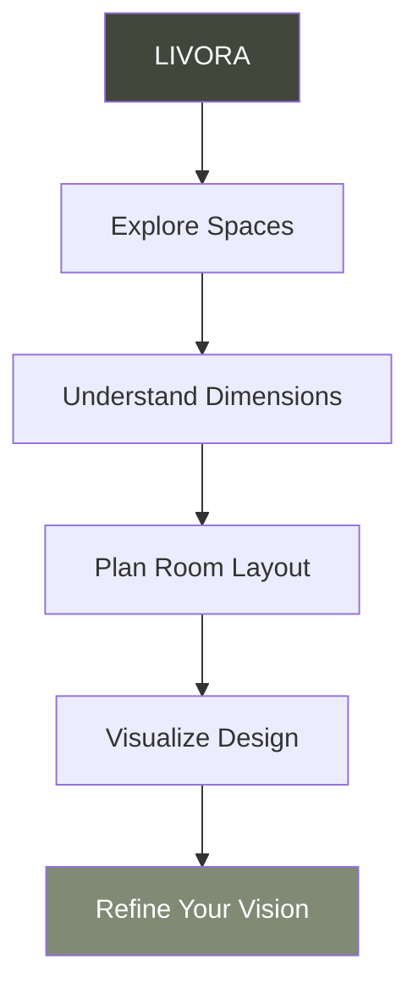

<div align="center">


<br/>


# L I V O R A

### ARCHITECTURAL 3D ROOM PLANNING

**Design Every Room Before You Move a Single Piece.**

[](https://livora-seven-ebon.vercel.app/)

*DESIGN · DEPTH · EXPERIENCE*

</div>

---

<div align="center">


</div>

# 01 — THE VISION

**What if you could experience your room before moving a single piece of furniture?**

LIVORA is an architectural 3D room-planning experience designed to transform how people visualize, explore, and plan their living spaces.

Combining architectural aesthetics, spatial visualization, and modern web experiences, LIVORA aims to make interior planning more intuitive and engaging.

> A room is more than four walls. It is an experience waiting to be designed.

# 02 — THE EXPERIENCE

<div align="center">


</div>

### EXPLORE

Discover possibilities through an architecture-inspired digital experience.

### VISUALIZE

Understand spatial arrangements and interior design concepts.

### PLAN

Think about room layouts, furniture arrangements, and proportions.

### EXPERIENCE

Bring your design vision closer to reality through visualization.

# 03 — DESIGN IDENTITY

| Element | Design |
|---|---|
| Brand | LIVORA |
| Logo | Geometric architectural cube |
| Background | Warm Ivory |
| Typography | Editorial Serif |
| Primary text | Charcoal |
| Accent | Muted Sage |
| Visual direction | Minimalist Luxury |
| Theme | Architectural 3D Planning |

### Colour Palette

<div align="center">

`#F3F0E8` IVORY · `#30312D` CHARCOAL · `#818A75` SAGE · `#D8D2C7` STONE

</div>

# 04 — PLATFORM WORKFLOW



# 05 — TECHNOLOGY STACK

The exact technologies should match the dependencies in the project repository.

| Layer | Technology |
|---|---|
| Deployment | Vercel |
| Frontend | Check package.json |
| Styling | Check package.json |
| 3D Rendering | Check package.json |
| Animation | Check package.json |
| Version Control | Git & GitHub |

# 06 — PROJECT STRUCTURE

```text
LIVORA/
│
├── assets/
│   ├── livora-3d-orbit.gif
│   ├── livora-logo.png
│   ├── livora-branding.png
│   └── livora-interior-hero.png
│
├── public/
├── src/
├── package.json
└── README.md
```

# 07 — RUN LOCALLY

### Prerequisites

- Node.js
- npm
- Git

### Clone the repository

```bash
git clone YOUR_GITHUB_REPOSITORY_URL
```

### Navigate into the project

```bash
cd YOUR_PROJECT_FOLDER
```

### Install dependencies

```bash
npm install
```

### Start the development server

```bash
npm run dev
```

Open the local URL displayed in your terminal.

# 08 — DEPLOYMENT

LIVORA is deployed using Vercel.

**Live Website:**

[https://livora-seven-ebon.vercel.app/](https://livora-seven-ebon.vercel.app/)

To deploy your own version:

1. Push the project to GitHub.
2. Import the repository into Vercel.
3. Configure the build settings.
4. Deploy the application.

# 09 — FUTURE ROADMAP

Potential future improvements:

- [ ] Interactive 3D room customization
- [ ] Real-time furniture placement
- [ ] Adjustable room dimensions
- [ ] Material and texture customization
- [ ] AI-powered interior recommendations
- [ ] Virtual room walkthroughs
- [ ] Save and share room designs
- [ ] Multiple architectural styles

# 10 — CONTRIBUTION

Contributions and suggestions are welcome.

1. Fork the repository.
2. Create a new branch.
3. Make your changes.
4. Test your implementation.
5. Submit a pull request.

---

<div align="center">


# L I V O R A

### SPACE. FORM. EXPERIENCE.

**Design Every Room Before You Move a Single Piece.**

[](https://livora-seven-ebon.vercel.app/)

*DESIGN · DEPTH · EXPERIENCE*

</div>
